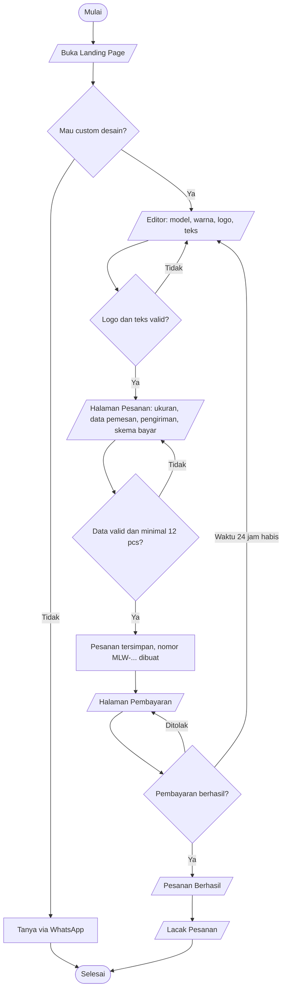
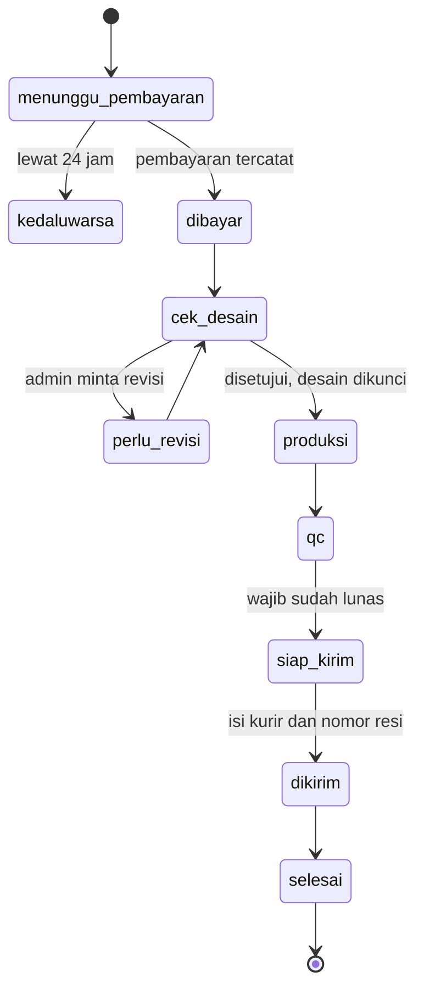
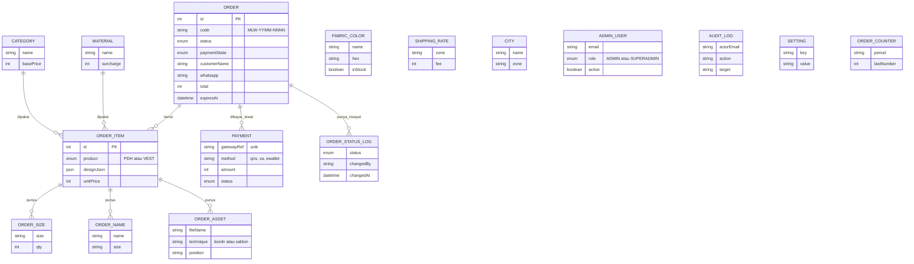

<div align="center">


<a href="https://github.com/rramaaare/mulawarmanesia">
  
</a>

<br/>


**Website profil bisnis + kustomisasi dan pemesanan seragam PDH & VEST**
*Digital Innovation for Local Impact*

</div>

---

## 📚 Daftar Isi

- [📌 Deskripsi Website](#-deskripsi-website)
- [🎯 Tujuan Pengembangan](#-tujuan-pengembangan)
- [⚙️ Fitur Utama](#️-fitur-utama)
- [🧰 Teknologi yang Digunakan](#-teknologi-yang-digunakan)
- [🧭 Perancangan Sistem](#-perancangan-sistem)
- [🚀 Cara Menjalankan Proyek](#-cara-menjalankan-proyek)
- [📁 Struktur Proyek](#-struktur-proyek)
- [🛡️ Integritas Data (ACID)](#️-integritas-data-acid)
- [📝 Catatan Demo](#-catatan-demo)
- [👥 Anggota Tim](#-anggota-tim)
- [🙏 Atribusi](#-atribusi)

---

## 📌 Deskripsi Website

**MULAWARMANESIA** adalah website untuk vendor konveksi di **Samarinda, Kalimantan Timur** yang melayani pembuatan seragam **PDH** dan **VEST**. Selain sebagai profil bisnis, website ini membuat pelanggan bisa **mendesain seragam sendiri**, **memesan**, **membayar**, dan **melacak pesanan** tanpa harus bolak-balik chat.

Selama ini pesan seragam di UMKM konveksi biasanya lewat WhatsApp: tanya model, kirim contoh gambar, tawar-menawar, transfer manual, lalu menunggu tanpa kabar. Website ini mengubah proses itu jadi alur yang jelas dan bisa dijalankan sendiri oleh pelanggan.

> Dibuat untuk **Lomba Pengembangan Website FUAD FAIR 2026** (UINSI Samarinda)
> Tema: *Digital Innovation for Local Impact* · Kategori: **Local Business Innovation** (Bisnis dan UMKM)

Pengguna website ini ada tiga:

| Pengguna | Yang bisa dilakukan |
|---|---|
| 🧑 **Pelanggan** | Lihat produk, buat desain, pesan, bayar, dan lacak pesanan. Tidak perlu login. |
| 👷 **Admin** | Lihat dashboard, kelola pesanan, ubah status produksi, ekspor CSV. |
| 🛠️ **Superadmin** | Semua hak admin, ditambah master data, akun admin, pengaturan, dan log aktivitas. |

---

## 🎯 Tujuan Pengembangan

a. Mempermudah pelanggan memesan seragam tanpa harus chat berulang kali.

b. Membuat proses pemesanan lebih jelas, mulai dari desain, harga, pembayaran, sampai pengiriman.

c. Membantu vendor konveksi mengelola pesanan dan produksi dalam satu tempat.

d. Mengurangi salah paham soal desain, ukuran, dan harga karena semuanya tercatat di sistem.

e. Mendukung UMKM lokal agar lebih siap bersaing lewat pemanfaatan teknologi digital.

---

## ⚙️ Fitur Utama

### 🧑 Fitur untuk Pelanggan

**🏠 Landing Page**
Halaman awal berisi profil usaha, produk PDH & VEST, cara pesan, portofolio, dan testimoni, lengkap dengan efek paralaks.

**🎨 Editor Desain**
Pelanggan bisa membuat desain seragam langsung di browser:
- Pilih model (PDH atau VEST), kategori desain, dan bahan
- Atur warna tiap bagian pakaian
- Unggah logo (posisi, ukuran, teknik bordir atau sablon)
- Tambah teks nama atau instansi
- Lihat tampak depan dan belakang, plus undo/redo dan zoom
- Draf tersimpan otomatis, jadi tidak hilang kalau tab ditutup

**🧾 Halaman Pesanan**
Isi ukuran dan jumlah (bisa pakai nama per orang), data pemesan, pengiriman (kirim ke alamat atau ambil di workshop), lalu pilih bayar **Lunas** atau **DP 50%**.

**💳 Pembayaran**
Pilih metode QRIS, Virtual Account, atau e-wallet lewat payment gateway. Pada versi demo dipakai simulator gateway.

**🔎 Lacak Pesanan**
Cek status pakai nomor pesanan dan nomor WhatsApp, lengkap dengan timeline 8 tahap.

### 👷 Fitur untuk Admin

**📊 Dashboard**
Ringkasan pesanan dan pendapatan, tren penjualan, kategori dan ukuran terlaris, kapasitas produksi, konversi, dan warna kain yang paling laku.

**📦 Kelola Pesanan**
Lihat daftar pesanan dengan filter status, buka detail desain dan unduh file logo, ubah status produksi, minta revisi ke pelanggan, dan ekspor data ke CSV.

**🏭 Produksi**
Antrean kerja workshop: pesanan yang sedang diproduksi, di tahap QC, dan siap kirim.

### 🛠️ Fitur Tambahan Superadmin

**🗂️ Master Data**
Atur harga dasar, biaya dekorasi, palet warna dan stok kain, serta tarif ongkir.

**👤 Akun Admin**
Tambah akun, nonaktifkan akun, dan reset kata sandi.

**⚙️ Pengaturan**
Atur kapasitas produksi mingguan dan batas waktu bayar pesanan baru.

**📜 Log Aktivitas**
Catatan perubahan harga, stok, ongkir, akun, pengaturan, dan status pesanan.

---

## 🧰 Teknologi yang Digunakan

| Bagian | Teknologi | Fungsi |
|---|---|---|
| Kerangka | **Next.js** (App Router) + **React** + **TypeScript** | Halaman web dan API dalam satu proyek |
| Tampilan | **Tailwind CSS v4**, font **Poppins**, gaya neo-brutalism | Desain antarmuka |
| Database | **MySQL 8** (InnoDB) lewat **Prisma ORM** | Menyimpan data pesanan, harga, dan akun |
| Validasi | **Zod** | Satu aturan validasi untuk browser dan server |
| Animasi | **GSAP ScrollTrigger** | Efek paralaks di landing page |
| Grafik | **Recharts** | Grafik di dashboard admin |
| Keamanan | **bcryptjs** + cookie login bertanda tangan HMAC | Login admin |
| Pengujian | **Vitest** | Tes domain dan tes ACID |
| Pendukung | Laragon, Git & GitHub, draw.io, FigCraft | Database lokal, versi kode, diagram, dan desain UI |

---

## 🧭 Perancangan Sistem

### 🔄 Alur Pemesanan Pelanggan



### 🏷️ Status Pesanan

Status hanya boleh maju satu tahap. Satu-satunya yang boleh bolak-balik adalah **Cek desain** dan **Perlu revisi**.



### 🗂️ ERD (Entity Relationship Diagram)



### 📐 Alur Kode

```
Browser (pelanggan)
   │  membuka halaman / mengisi form
   ▼
app/<halaman>/page.tsx        ← halaman (Server Component)
   ▼
features/<fitur>/*.tsx        ← komponen interaktif ("use client")
   │  fetch("/api/...")
   ▼
app/api/<endpoint>/route.ts   ← pintu API (tipis, hanya memanggil service)
   ▼
server/services/*.ts          ← logika + transaksi database
   │            ▲
   │            └── lib/domain/*.ts  aturan murni (harga, status)
   ▼
Prisma → MySQL
```

Panduan lengkap untuk membaca dan menjelaskan kode ada di [`docs/ALUR-KODE.md`](docs/ALUR-KODE.md).

---

## 🚀 Cara Menjalankan Proyek

### 1️⃣ Yang Perlu Disiapkan

- **Node.js 20** atau lebih baru
- **MySQL 8** (paling mudah lewat [Laragon](https://laragon.org/))
- **Git**

### 2️⃣ Langkah-langkah

**1. Unduh proyek**

```bash
git clone https://github.com/rramaaare/mulawarmanesia.git
cd mulawarmanesia
```

**2. Pasang library**

```bash
npm install
```

**3. Salin file konfigurasi**

```bash
cp .env.example .env          # Windows: copy .env.example .env
```

Lalu buka `.env` dan isi nilainya:

| Variabel | Isi |
|---|---|
| `DATABASE_URL` | Alamat database. Bawaan Laragon: `mysql://root:@localhost:3306/mulawarmanesia` |
| `SESSION_SECRET` | Kunci rahasia acak untuk cookie login (minimal 32 karakter) |
| `PAYMENT_WEBHOOK_SECRET` | Kunci rahasia untuk tanda tangan webhook simulator pembayaran |
| `ADMIN_EMAIL` dan `ADMIN_PASSWORD` | Akun admin awal |
| `SUPERADMIN_EMAIL` dan `SUPERADMIN_PASSWORD` | Akun superadmin awal |
| `ENABLE_PAYMENT_SIMULATOR` | Isi `"true"` untuk demo |

**4. Siapkan database**

Buat database kosong bernama `mulawarmanesia` di MySQL, lalu jalankan:

```bash
npx prisma migrate deploy     # membuat tabel
npx prisma generate           # membuat tipe Prisma
npm run seed                  # data master + akun admin dari .env
npm run seed:demo             # (opsional) pesanan contoh untuk dashboard
```

**5. Jalankan website**

```bash
npm run dev
```

Buka **http://localhost:3000** di browser. 🎉

### 3️⃣ Alamat Penting

| Halaman | Alamat |
|---|---|
| Landing page | `/` |
| Editor desain | `/editor` |
| Lacak pesanan | `/lacak` |
| Login admin | `/admin/login` |

### 4️⃣ Perintah Lain

```bash
npm test            # tes domain + tes ACID (butuh MySQL yang sudah di-seed)
npm run lint        # cek gaya kode
npm run build       # build produksi
npm start           # jalankan hasil build
```

---

## 📁 Struktur Proyek

```
app/            halaman (URL) dan route API tipis
components/     komponen UI yang dipakai ulang (Button, Card, Field, Modal, Garment, ...)
features/       komponen per fitur: landing, editor, order, payment, status, tracking, admin
lib/domain/     aturan bisnis murni: harga, urutan status, nomor pesanan, nomor WhatsApp
lib/validation/ aturan validasi Zod (dipakai browser dan server)
server/         service (logika + transaksi database), login admin, upload file
prisma/         skema database, migrasi, seed
tests/          tes otomatis
docs/           PRD, desain, dan panduan membaca kode
```

---

## 🛡️ Integritas Data (ACID)

- Checkout menulis semua tabel pesanan dalam **satu transaksi**. Kalau gagal di tengah jalan, tidak ada data setengah jadi.
- Nomor pesanan `MLW-YYMM-NNNN` dibuat dari penghitung yang dikunci, jadi checkout bersamaan tidak menghasilkan nomor kembar.
- Webhook pembayaran **idempoten**: dikirim dua kali pun, uang hanya tercatat sekali.
- Urutan status dan aturan DP dijaga di **server**, bukan hanya di tombol.
- Harga selalu dihitung ulang di server, jadi tidak bisa diakali dari browser.
- Peran admin dicek di server pada setiap permintaan, bukan hanya disembunyikan di menu.
- File logo diperiksa isinya (bukan hanya ekstensi), maksimal 5 MB, dan SVG berskrip ditolak.

Semua ini diuji otomatis di `tests/acid.test.ts`.

---

## 📝 Catatan Demo

- Pembayaran memakai **simulator gateway** (`/gateway/...`) yang mengirim webhook bertanda tangan HMAC lewat jalur yang sama dengan webhook asli. Penyedia nyata seperti Midtrans atau Xendit bisa dipasang kemudian tanpa mengubah halaman.
- Harga, minimal order, durasi produksi, alamat, dan testimoni adalah **data contoh**.
- Belum tersedia: notifikasi email/WhatsApp otomatis, 2FA admin, halaman laporan, dan unduh PNG desain.

---

## 👥 Anggota Tim

<div align="center">

| **Nama** | **NIM** | **Kelas** | **GitHub** |
|---|---|---|---|
| (isi nama ketua) | (isi NIM) | (isi kelas) | [](https://github.com/rramaaare) |
| (isi nama anggota 2) | (isi NIM) | (isi kelas) | [](https://github.com/) |
| (isi nama anggota 3) | (isi NIM) | (isi kelas) | [](https://github.com/) |

</div>

---

## 🙏 Atribusi

- Font [Poppins](https://fonts.google.com/specimen/Poppins) (SIL Open Font License).
- Library open source: Next.js, React, Tailwind CSS, Prisma, Zod, GSAP, Recharts, bcryptjs, Vitest (lisensi masing-masing).
- Ilustrasi garmen dibuat sendiri sebagai SVG.
- Desain antarmuka dibuat di FigCraft (`docs/MULAWARMANESIA Website v1.figcraft`).
- Pengembangan dibantu AI (diperbolehkan oleh juknis lomba).

<div align="center">

<br/>

**Dibuat dengan ❤️ untuk UMKM konveksi Samarinda**

[⬆️ Kembali ke Awal](#)


</div>
